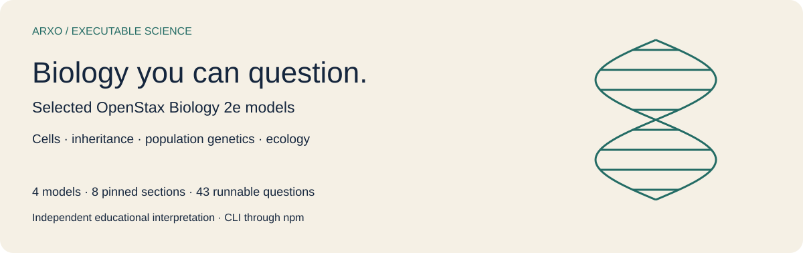
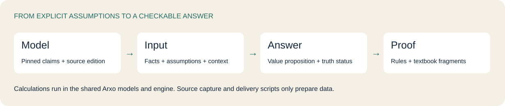
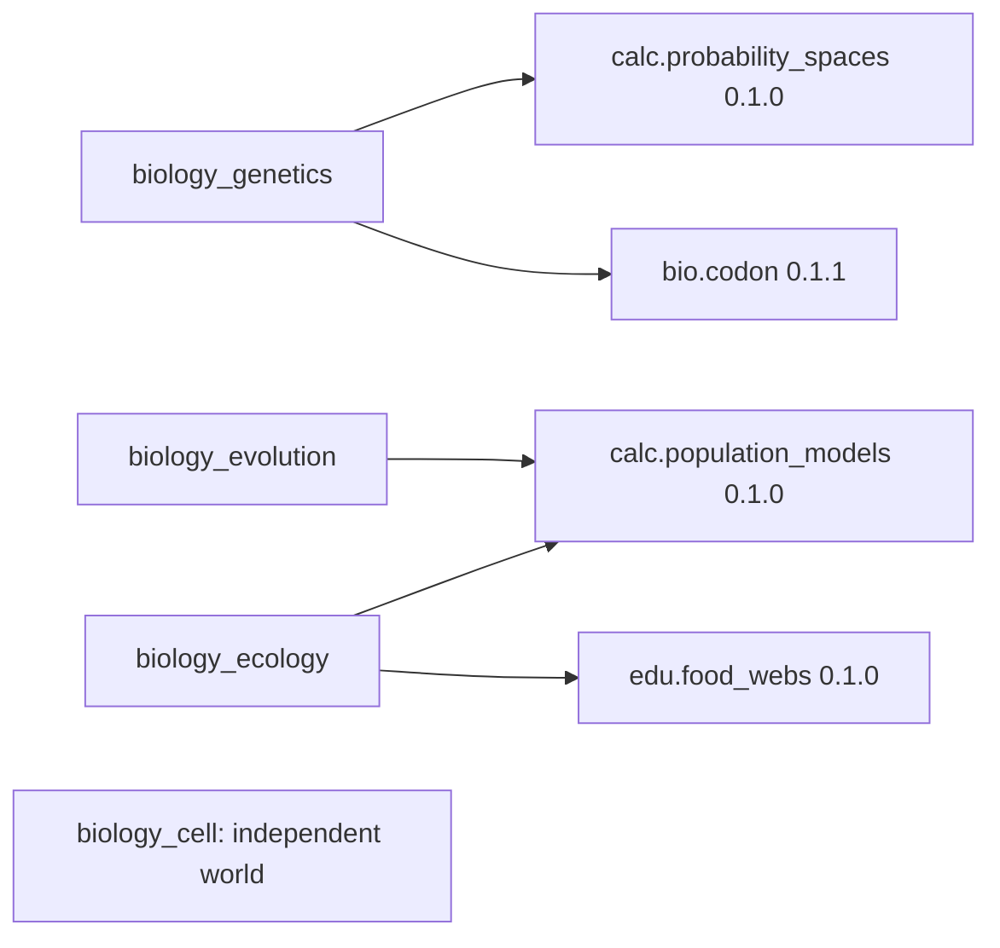
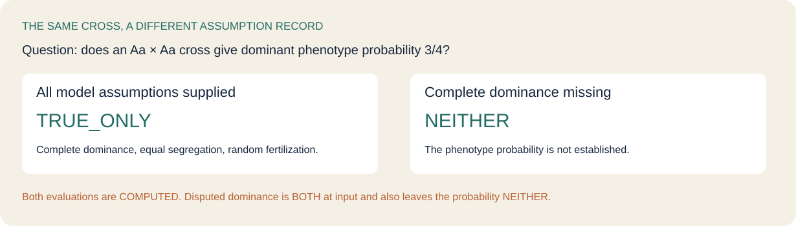
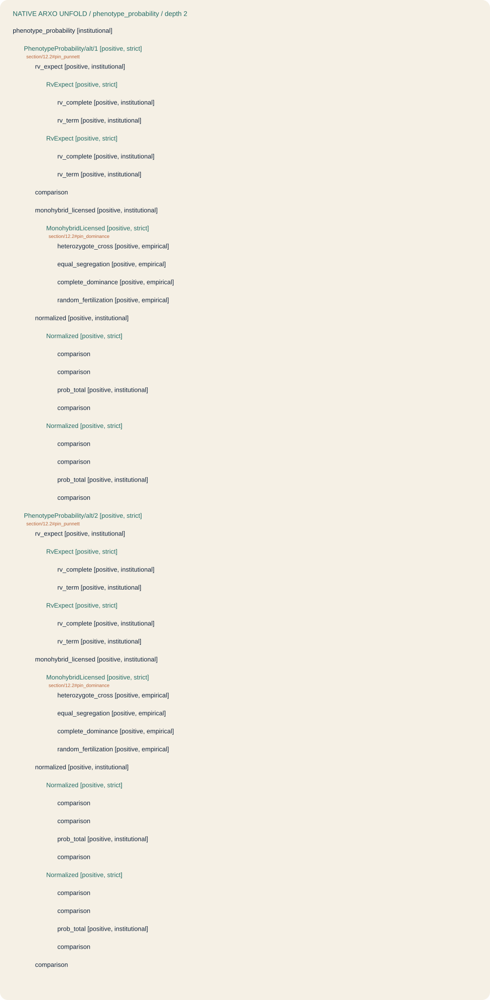

# OpenStax biology on Arxo

Run selected **Biology 2e** models, inspect their conclusions and see which facts and assumptions make an answer possible. This independent educational repository contains **four source-linked models**, their four dependencies, eight pinned textbook sections and **43 runnable questions**.

[Run a question](#run-a-question) · [Choose a model](#choose-a-model) · [Inputs and answers](#inputs-and-answers) · [Explore examples](#explore-examples) · [Depth and boundaries](#depth-and-boundaries) · [Reproduce](#reproduce) · [Licenses](#licenses)

## Run a question

Install the published Arxo CLI through npm with **Node.js 20+**, then obtain the models from GitHub:

```sh
npm install -g @arxo/cli@0.2.5
git clone https://github.com/arxohq/arxo-openstax-biology.git
cd arxo-openstax-biology
law eval examples/monohybrid-dominant
```

This asks whether the dominant phenotype probability is **3/4** for an **Aa × Aa** cross at one diploid biallelic locus. The input explicitly supplies complete dominance, equal allele segregation and equally likely gamete combinations. Arxo builds the four Punnett outcomes and computes the indicator's expectation through `calc.probability_spaces`. The proposition is `TRUE_ONLY` with evaluation status `COMPUTED`.

```sh
law eval examples/missing-dominance
law inspect examples/monohybrid-dominant/result.json summary
```

Without the complete-dominance assumption, the same probability proposition is **`NEITHER`**. The model does not silently substitute a dominance pattern.

Models arrive through GitHub and the [v0.1.0 release](https://github.com/arxohq/arxo-openstax-biology/releases/tag/v0.1.0). There is no model npm package; npm installs the runtime.



## Choose a model

All four entry versions are **`0.1.0`**, with semantics **`law.core/0.2.11`**. These are separate, restricted educational models. Section numbers identify selected source snapshots, not complete chapter coverage.

| Exact model | Selected source and behavior | Explore |
|---|---|---|
| `openstax.biology_cell@0.1.0` | 4.3 · three selected organelle functions | [.law and sources](packages/openstax.biology_cell) |
| `openstax.biology_genetics@0.1.0` | 12.2, 12.3, 15.1 · a restricted monohybrid cross and selected genetic code | [.law and sources](packages/openstax.biology_genetics) |
| `openstax.biology_evolution@0.1.0` | 19.1, 19.2 · ideal Hardy–Weinberg genotype frequencies | [.law and sources](packages/openstax.biology_evolution) |
| `openstax.biology_ecology@0.1.0` | 45.3, 46.1 · bounded bacterial doubling and a synthetic teaching food chain | [.law and sources](packages/openstax.biology_ecology) |

The actual import closure is [`calc.probability_spaces@0.1.0`](packages/calc.probability_spaces), [`bio.codon@0.1.1`](packages/bio.codon), [`calc.population_models@0.1.0`](packages/calc.population_models) and [`edu.food_webs@0.1.0`](packages/edu.food_webs). The first release exports the three types already used by `bio.codon`'s public relations; its code tables, rule bodies and publisher bytes remain unchanged. Original `0.1.0` IR is retained separately.



Exact identities, dependency versions and hashes are recorded in [models.json](models.json), [source-pin.json](source-pin.json) and each package's `law.lock`.

## Inputs and answers

Each example contains a complete **`request.json`**, readable `case.json` and `query.json`, native expectations and a captured result. Context includes the dates required to resolve the pinned source editions; every empirical assertion retains its `case_input` origin. Fixtures were compiled from `.lawtest` by the released CLI, including every question of multi-step cases.

| Example | Complete input outline | Asked result |
|---|---|---|
| [monohybrid-dominant](examples/monohybrid-dominant) | Aa × Aa; complete dominance, equal segregation, random fertilization | probability 3/4: `TRUE_ONLY` |
| [hardy-weinberg-frequencies](examples/hardy-weinberg-frequencies) | p=3/5, q=2/5; random mating, ideal infinite population, no mutation, migration or selection | Aa frequency 12/25: `TRUE_ONLY` |
| [bacterial-doubling](examples/bacterial-doubling) | doubling profile; unlimited-resource assumption; initial count 1000; horizon 3 generations | generation 3 count 8000: `TRUE_ONLY` |
| [standard-code-uga](examples/standard-code-uga) | presented UGA at position 0, frame origin 0, NCBI table 1 selected | Stop product: `TRUE_ONLY` |
| [mitochondrial-code-uga](examples/mitochondrial-code-uga) | same presented codon; vertebrate mitochondrial table 2 selected | Trp product: `TRUE_ONLY` |
| [synthetic-food-chain](examples/synthetic-food-chain) | explicit Arxo meadow profile; presented rabbit→grass and fox→rabbit feeding links | chain consistency: `TRUE_ONLY` |

All calculations run in the shared Arxo engine/models. A calculated model expectation is conditional on its supplied premises; it does not establish that a real population or laboratory sample meets them. The food web is Arxo-authored teaching data, not an OpenStax field observation.



### Unknown, refuted and disputed

`NEITHER` means this proposition is not established by the supplied model. It does not mean zero or false. `FALSE_ONLY` is an explicit refutation, as in a proposed ribosome photosynthesis function or an incorrect probability. `BOTH` preserves conflicting positive/negative input records; the model's ordinary premises require `TRUE_ONLY`, so disputed assumptions do not license an ordinary answer.

`invalid-allele-frequencies`, `unsupported-generation-horizon` and `invented-feeding-link` ask diagnostic predicates. Their `TRUE_ONLY` answers establish the **defect**, not a successful scientific calculation.

To edit a case, copy an example to a new directory and edit the **`case` in `request.json`**, then run `law eval` on that directory. The sibling `case.json` and `query.json` are readable exports; they do not override `request.json`. Keep origin, explicit negative assertions, dates and model assumptions visible.

## Explore examples

Use `law eval examples/<name>`. Every row below is a captured native question, not a copied historical PASS.

| Example | Model | Truth | Evaluation |
|---|---|---|---|
| [ribosome-function](examples/ribosome-function) | `cell@0.1.0` | `TRUE_ONLY` | `COMPUTED` |
| [chloroplast-function](examples/chloroplast-function) | `cell@0.1.0` | `TRUE_ONLY` | `COMPUTED` |
| [mitochondrion-function](examples/mitochondrion-function) | `cell@0.1.0` | `TRUE_ONLY` | `COMPUTED` |
| [wrong-organelle-function](examples/wrong-organelle-function) | `cell@0.1.0` | `FALSE_ONLY` | `COMPUTED` |
| [unknown-organelle](examples/unknown-organelle) | `cell@0.1.0` | `NEITHER` | `COMPUTED` |
| [disputed-organelle-input-status](examples/disputed-organelle-input-status) | `cell@0.1.0` | `BOTH` | `COMPUTED` |
| [disputed-organelle](examples/disputed-organelle) | `cell@0.1.0` | `NEITHER` | `COMPUTED` |
| [monohybrid-dominant](examples/monohybrid-dominant) | `genetics@0.1.0` | `TRUE_ONLY` | `COMPUTED` |
| [monohybrid-recessive](examples/monohybrid-recessive) | `genetics@0.1.0` | `TRUE_ONLY` | `COMPUTED` |
| [wrong-phenotype-probability](examples/wrong-phenotype-probability) | `genetics@0.1.0` | `FALSE_ONLY` | `COMPUTED` |
| [missing-dominance](examples/missing-dominance) | `genetics@0.1.0` | `NEITHER` | `COMPUTED` |
| [disputed-dominance-input-status](examples/disputed-dominance-input-status) | `genetics@0.1.0` | `BOTH` | `COMPUTED` |
| [disputed-dominance](examples/disputed-dominance) | `genetics@0.1.0` | `NEITHER` | `COMPUTED` |
| [standard-code-uga](examples/standard-code-uga) | `genetics@0.1.0` | `TRUE_ONLY` | `COMPUTED` |
| [mitochondrial-code-uga](examples/mitochondrial-code-uga) | `genetics@0.1.0` | `TRUE_ONLY` | `COMPUTED` |
| [mitochondrial-code-not-stop](examples/mitochondrial-code-not-stop) | `genetics@0.1.0` | `NEITHER` | `COMPUTED` |
| [missing-code-selection](examples/missing-code-selection) | `genetics@0.1.0` | `NEITHER` | `COMPUTED` |
| [ambiguous-code-selection](examples/ambiguous-code-selection) | `genetics@0.1.0` | `NEITHER` | `COMPUTED` |
| [hardy-weinberg-homozygous-dominant](examples/hardy-weinberg-homozygous-dominant) | `evolution@0.1.0` | `TRUE_ONLY` | `COMPUTED` |
| [hardy-weinberg-frequencies](examples/hardy-weinberg-frequencies) | `evolution@0.1.0` | `TRUE_ONLY` | `COMPUTED` |
| [hardy-weinberg-homozygous-recessive](examples/hardy-weinberg-homozygous-recessive) | `evolution@0.1.0` | `TRUE_ONLY` | `COMPUTED` |
| [missing-random-mating](examples/missing-random-mating) | `evolution@0.1.0` | `NEITHER` | `COMPUTED` |
| [migration-not-excluded](examples/migration-not-excluded) | `evolution@0.1.0` | `NEITHER` | `COMPUTED` |
| [disputed-random-mating-input-status](examples/disputed-random-mating-input-status) | `evolution@0.1.0` | `BOTH` | `COMPUTED` |
| [disputed-random-mating](examples/disputed-random-mating) | `evolution@0.1.0` | `NEITHER` | `COMPUTED` |
| [invalid-allele-frequencies](examples/invalid-allele-frequencies) | `evolution@0.1.0` | `TRUE_ONLY` | `COMPUTED` |
| [invalid-alleles-no-frequency](examples/invalid-alleles-no-frequency) | `evolution@0.1.0` | `NEITHER` | `COMPUTED` |
| [ambiguous-allele-input](examples/ambiguous-allele-input) | `evolution@0.1.0` | `NEITHER` | `COMPUTED` |
| [bacterial-initial-count](examples/bacterial-initial-count) | `ecology@0.1.0` | `TRUE_ONLY` | `COMPUTED` |
| [bacterial-doubling](examples/bacterial-doubling) | `ecology@0.1.0` | `TRUE_ONLY` | `COMPUTED` |
| [bacterial-beyond-horizon](examples/bacterial-beyond-horizon) | `ecology@0.1.0` | `NEITHER` | `COMPUTED` |
| [missing-resource-assumption](examples/missing-resource-assumption) | `ecology@0.1.0` | `NEITHER` | `COMPUTED` |
| [disputed-resource-assumption-input-status](examples/disputed-resource-assumption-input-status) | `ecology@0.1.0` | `BOTH` | `COMPUTED` |
| [disputed-resource-assumption](examples/disputed-resource-assumption) | `ecology@0.1.0` | `NEITHER` | `COMPUTED` |
| [unsupported-generation-horizon](examples/unsupported-generation-horizon) | `ecology@0.1.0` | `TRUE_ONLY` | `COMPUTED` |
| [unsupported-horizon-no-population](examples/unsupported-horizon-no-population) | `ecology@0.1.0` | `NEITHER` | `COMPUTED` |
| [ambiguous-initial-count](examples/ambiguous-initial-count) | `ecology@0.1.0` | `NEITHER` | `COMPUTED` |
| [synthetic-food-chain](examples/synthetic-food-chain) | `ecology@0.1.0` | `TRUE_ONLY` | `COMPUTED` |
| [invented-feeding-link](examples/invented-feeding-link) | `ecology@0.1.0` | `TRUE_ONLY` | `COMPUTED` |
| [invented-link-no-chain](examples/invented-link-no-chain) | `ecology@0.1.0` | `NEITHER` | `COMPUTED` |
| [unknown-food-web-species](examples/unknown-food-web-species) | `ecology@0.1.0` | `NEITHER` | `COMPUTED` |
| [zero-generation-horizon](examples/zero-generation-horizon) | `ecology@0.1.0` | `TRUE_ONLY` | `COMPUTED` |
| [maximum-generation-horizon](examples/maximum-generation-horizon) | `ecology@0.1.0` | `TRUE_ONLY` | `COMPUTED` |

### Inspect the proof

```sh
law inspect examples/monohybrid-dominant/result.json summary
law test packages/openstax.biology_genetics --file tests/biology-genetics.lawtest
```

The full [result](examples/monohybrid-dominant/result.json) preserves the canonical result hash and `proofGraph` rule IDs. Evaluation `sourceAnchors` arrays are empty in these captures; direct propagation is not claimed as passed. The source annotations and exact fragments remain in the program and are independently resolved by native `unfold`.

<details>
<summary>Open the native phenotype_probability tree</summary>



```sh
law engine unfold registry/world/openstax.biology_genetics.lawir.json   phenotype_probability --clir registry/package --depth 2 --lang en --json
```

This is the model's native reasoning structure, not a case proof or a separate formula implementation. [Captured tree](reports/unfold-genetics.json).

</details>

## Depth and boundaries

Depth is measured for **all four Biology 2e models**, using the existing `boundaries.depth` classifier. The unit is a **publisher section in its exact captured text snapshot**. Literal section headings form the denominator; example numbers, figures and decimal values do not. Source and edition hashes prevent another edition lending anchors. Own package nodes are counted; imports are excluded.

`EXECUTABLE` means that a deriving rule is anchored to a fragment in that unit. It establishes a structural connection to selected claims, **not complete formalization of the section, scientific validation or complete coverage of the textbook**.

| Package | Section snapshots | EXECUTABLE | Selected fragments | Own rules |
|---|---:|---:|---:|---:|
| `openstax.biology_cell@0.1.0` | 1 | 1 | 3 | 5 |
| `openstax.biology_genetics@0.1.0` | 3 | 3 | 4 | 19 |
| `openstax.biology_evolution@0.1.0` | 2 | 2 | 3 | 9 |
| `openstax.biology_ecology@0.1.0` | 2 | 2 | 2 | 10 |

The [per-unit report](reports/formalization-depth.json) retains denominator, editions, source/package/declaration/implementation hashes, deriving counts, unanchored helper rules and unmeasured publications. This release adds selected deriving rules to each of the eight captured sections; the other content of those sections remains outside the executable claim.

The three source-free technical/teaching dependencies have no textbook division and remain `not_measured`. `bio.codon` pins NCBI HTML tables; this delivery does not invent an OpenStax-section measure for that source. Its publication identity and targeted execution are recorded separately.

```sh
python3.12 tools/measure_depth.py --check
```

This standard-library-only command reproduces all four measurements from the public archive without a private corpus or evaluator. [Measurement method](docs/depth.md).

Boundaries that matter:

- **Cell** maps three presented structures to selected functions. It does not identify structures from images, enumerate every organelle or infer that every cell contains those structures.
- **Genetics** restricts the probability model to one Aa × Aa locus with complete dominance and explicitly supplied segregation/fertilization assumptions. It does not infer parental genotypes or handle linkage, incomplete dominance, clinical pedigrees or arbitrary crosses.
- Codon lookup requires one explicitly selected NCBI table and a presented codon. This slice does not parse an RNA sequence or expose SECIS recoding as a cross-package input.
- **Evolution** computes a diallelic ideal Hardy–Weinberg baseline. The ideal infinite-population premise is a model assumption, not a factual claim about a real finite population. Drift, mutation/selection dynamics and parameter estimation are outside this slice.
- **Ecology** derives a finite doubling trajectory, with supplied nonnegative integer initial count and horizon 0–24 generations. It does not forecast real resource depletion, fit growth parameters or compute logistic trajectories. Multiple initial counts/horizons remain unresolved.
- The teaching food web checks presented links against an explicitly selected synthetic profile. No universal 10% energy-transfer factor or real ecosystem validation is inferred.
- These science models use institutional predicates for derived outputs; they do not encode deontic duties/prohibitions. Missing or disputed inputs remain visible.
- Publisher extracts retain their captured bytes. Plain text can lose superscripts, fractions and layout; consult the official formatted pages for mathematical notation.

## Reproduce

Python 3.12 is needed for maintenance checks; ordinary reader use needs only the npm CLI.

```sh
python3.12 tools/check.py
python3.12 tools/measure_depth.py --check
python3.12 tools/test_section_depth.py
```

The first command checks supplied hashes and replays all **43** questions twice, comparing complete canonical documents and result hashes. To also repeat only the explicitly recorded package suites:

```sh
python3.12 tools/check.py --packages
```

The preparation records **54 passed native cases**: all 31 cases of the four new models plus selected dependency cases. Every step of the new cases is captured separately as a reader question. Unexecuted dependency files are not reported as passed. [Verification](reports/verification.json) · [Source pin](source-pin.json) · [Runtime pin](toolchain.lock.json) · [Exact archive inventory](CANON-MANIFEST.json).

[Rebuild selected worlds](docs/reproduction.md) describes native imports, lowering, linking and fixture capture. Public CI checks this kit, with an ordinary npm installation; it does not scan the whole corpus. Full corpus is `not_checked`; `releaseVerified` remains `false`.

## Licenses

Biology 2e by **Mary Ann Clark, Matthew Douglas and Jung Choi**; OpenStax, Rice University and content contributors. Textbook content, excerpts and textual adaptations retain **CC BY-NC-SA 4.0**, including copies embedded in `.law`, CLIR and example requests. Independent Arxo code, technical models, teaching data and original SVG art use Apache-2.0. NCBI/NLM materials retain their own source attribution and usage notices; they are not relicensed as OpenStax content.

See [NOTICE](NOTICE), [full license texts](licenses), [OpenStax attribution](https://openstax.org/books/biology-2e/pages/preface) and [NCBI usage policies](https://www.ncbi.nlm.nih.gov/home/about/policies/). This is an independent project; no publisher endorsement is implied. No publisher logos, book cover or illustrations are used as artwork.

Access for free at [OpenStax Biology 2e](https://openstax.org/books/biology-2e/pages/1-introduction). OpenStax/Rice University and content contributors; textbook content and adaptations: [CC BY-NC-SA 4.0](licenses/CC-BY-NC-SA-4.0.txt).
